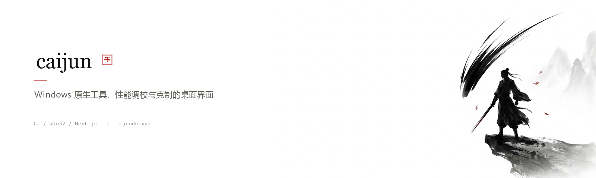

  

  <a href="https://cjcode.xyz">Blog · cjcode.xyz</a> &nbsp;·&nbsp;
  <a href="https://caijun-1.github.io/frameforge/">FrameForge Site</a> &nbsp;·&nbsp;
  <a href="https://github.com/caijun-1?tab=repositories">Repositories</a> &nbsp;·&nbsp;
  <a href="https://github.com/caijun-1/frameforge/discussions">Discussions</a>

  

### Selected Projects

| Project | Stack | Description |
| :--- | :--- | :--- |
| **[FrameForge](https://github.com/caijun-1/frameforge)** | C# / .NET 4.8 / Win32 | 约 7 MB 单文件 Windows FPS 增效工具：一键事务级可回滚加速、PresentMon / RTSS 现代 HUD、硬件画面滤镜与赛后战绩，默认零 DLL 注入 |
| **[qingpan](https://github.com/caijun-1/qingpan)** | Python / Windows | 清盘 · CleanDisk：极简单文件 Windows 磁盘清理工具，不联网、不上传数据，清理规则透明 |
| **[memsweep](https://github.com/caijun-1/memsweep)** | C# / Win32 | 101 KB 轻量 Windows 内存整理小工具，单文件即开即用，常驻开销极低 |
| **[video-to-ansi](https://github.com/caijun-1/video-to-ansi)** | Python | 将任意视频转换为终端字符动画（ASCII / ANSI）的轻量工具 |

  

### Featured · FrameForge

Windows 上克制而完整的 FPS 增效与帧率监测工具——单文件约 7 MB，默认零 DLL 注入，支持事务级 100% 崩溃自动回滚与现代毛玻璃 HUD。

  

  <a href="https://github.com/caijun-1/frameforge/releases/latest">Download Latest (v1.6.5)</a> &nbsp;·&nbsp;
  <a href="https://caijun-1.github.io/frameforge/">Interactive HUD Preview</a> &nbsp;·&nbsp;
  <a href="https://github.com/caijun-1/frameforge">Source Code (MIT)</a>

  

### Stack

  <picture>
    <source media="(prefers-color-scheme: dark)" srcset="https://skillicons.dev/icons?i=cs,dotnet,ts,nextjs,react,tailwind,py,powershell,git,github&theme=dark&perline=10" />
    
  </picture>

  

  <picture>
    <source media="(prefers-color-scheme: dark)" srcset="https://raw.githubusercontent.com/caijun-1/caijun-1/output/github-snake-dark.svg?v=2" />
    
  </picture>

